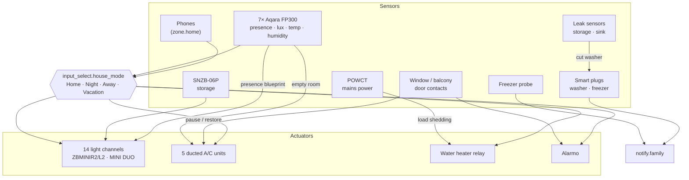

# Smart Apartment: Home Assistant config

Home Assistant configuration for an apartment I'm renovating, written **before
the build** from the renovation drawings. Every light switch gets a Zigbee
relay, every room gets an mmWave presence sensor, and the heat pump, water
heater and appliances are metered and controlled, so on day one the
apartment runs itself.

> Status: design ready, renovation in progress. Entity IDs are the target
> names in [docs/devices.md](docs/devices.md); pair the devices, rename them,
> and the automations work unchanged.

## What it does

| | |
|---|---|
| **Presence lighting in every room** | One reusable blueprint: lights follow the mmWave sensor, switch on only when it's dark, and never fight a person: switch a light off by hand and it stays off until the room empties. |
| **Night-aware** | In Night mode bedroom lights stay off, the kitchen only lights its counter LED, and a trip to the bathroom lights the hallway both ways, then switches it off. |
| **House modes** | `Home` / `Night` / `Away` / `Vacation`, worked out from phones and from the day zone going quiet after 22:30. Everything else reacts to the mode, not to raw sensors. |
| **Alarm that arms itself** | Alarmo arms Away when the last person leaves and Night when the house goes to bed, and only disarms itself from Night mode, when someone is already inside. |
| **"Did you forget...?"** | 75 s after leaving, one notification lists what needs a person: alarm not armed, open windows, washer running, freezer or leak alerts. If a window stopped the alarm, it has an **Arm anyway** button. |
| **Room temperature, not ceiling temperature** | Ducted units measure the air in the false ceiling. Every 5 min, each unit's setpoint is offset by how far the FP300 in the room is from the room's target, so the *room* gets to 21 °C. A change made in the app becomes the new target. |
| **Per-room climate** | An open window pauses that room's unit and restores the exact settings when it closes; a room empty for 45 min switches its unit off (bedrooms excepted at night). |
| **Open windows instead of A/C** | On summer evenings, once it is 2 °C cooler outside than inside, a suggestion to switch the A/C off and open up. |
| **Mould prevention** | A room above 70 % humidity for 3 h gets an hour of dry mode (if its unit supports it) and a notification. |
| **Water heater reconciler** | Schedule + 1 h boost button + house mode + load shedding, combined into one "should it be on?" rule that is re-applied every 10 min, so a missed event can never leave it on all day. |
| **Load shedding** | Whole-apartment power from a POWCT: above the limit, the water heater pauses before the main breaker trips. |
| **Water leaks** | Leak sensors in the storage room and under the kitchen sink: the washing machine is cut off at once and stays locked off until the floor is dry; the alert repeats every 5 min until then. |
| **Freezer** | A wired probe inside plus the plug's power reading: warns at -15 °C, alarms at -10 °C, and tells you *why* (lid open, compressor dead, or power cut). Its plug turns itself back on if anyone switches it off. |
| **Appliances** | "Wash finished" notification without false alarms during soak pauses. |
| **Cost in euros** | Today's and this month's electricity cost, and a forecast of the month's bill at the current pace; a report on the 1st of each month. |
| **Floor-plan dashboard** | The renovation drawing itself as the dashboard: lights, presence and temperatures on each room, tap to toggle; open windows and leaks appear in red / blue only when they happen. |
| **Maintenance** | A/C filter reminders by each unit's actual running hours, with the location of its access hatch; weekly low-battery report; alert when any mains-powered Zigbee device drops off the mesh. |

## How the pieces fit



## Repository layout

```
blueprints/automation/antkarag13/
  presence_lighting.yaml    reusable presence-lighting blueprint
packages/                   one self-contained file per feature (helpers + automations)
  house_modes.yaml
  lighting.yaml             8 blueprint instances, hallway, balconies
  security.yaml             Alarmo
  climate.yaml              window pause/restore, empty-room off, away
  energy.yaml               water heater, load shedding, washer, freezer
  water.yaml                leak detection, washer lockout
  maintenance.yaml          filters, batteries, offline devices
dashboards/apartment.yaml   floor plan, climate, energy and home views
www/floorplan/apartment.svg drawing 9γ, used as the dashboard background
docs/
  devices.md                bill of materials, areas, entity map, install notes
  alarmo.md                 which sensor is armed in which mode
configuration.example.yaml  how to load the packages
secrets.example.yaml
```

## Design choices

- **Areas and labels over entity lists.** Climate and balcony automations find
  "the unit in the same room as this window" with `area_id()`, and window
  checks use the `windows` label, so new devices need no YAML edits.
- **Purpose-specific triggers** (`occupancy.detected`, `window.opened`,
  `schedule.block_started`, `timer.finished`, HA 2026.7+) where they fit, with
  plain `to:`-only state triggers where an edge through `unavailable` must
  never be missed.
- **Reconcile, don't toggle.** The water heater automation computes the
  desired state from all inputs and applies it, instead of separate on/off
  automations that can drift.
- **Snapshot and restore.** An open window saves the unit's exact settings
  with `scene.create` and restores them, rather than guessing.
- **Room sensors close the loop.** The FP300 in each room, not the unit's
  ceiling sensor, decides whether a room is warm enough.
- **Every physical actuator has a failsafe.** Hallway auto-off, freezer plug
  that turns itself back on, offline-device alerts.

## Using it

1. Copy `packages/`, `blueprints/`, `dashboards/` and `www/` into your Home Assistant `/config`.
2. Merge `configuration.example.yaml` into `configuration.yaml`.
3. Copy `secrets.example.yaml` to `secrets.yaml` and set the Alarmo code.
4. Create the areas, the `apartment` floor and the `windows` label, and rename
   entities as in [docs/devices.md](docs/devices.md).
5. Set up Alarmo as in [docs/alarmo.md](docs/alarmo.md).
6. Set **A/C filter cleaning interval** to about 300 h. A new `input_number` starts at
   its minimum (50 h), which would ask for filter cleaning far too early.

Requires Home Assistant 2026.7 or newer and the [Alarmo](https://github.com/nielsfaber/alarmo) integration (HACS).

## License

[MIT](LICENSE) © 2026 Antonis Karagiannis
